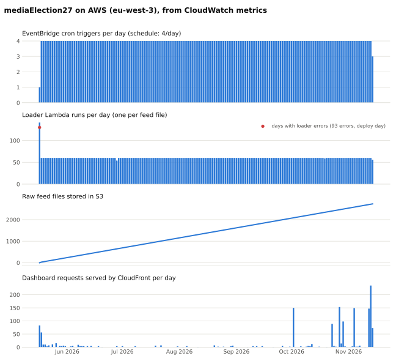

# Evidence: six months of autonomous operation on AWS

The pipeline described in the [main README](../../README.md) ran unattended
on AWS (`eu-west-3`) from **2026-05-16** until the AWS free plan ends on
**2026-11-16** (21:32 UTC), which closes the account. This folder records that
run, collected from AWS itself on **2026-11-14**, two days before the
shutdown, with `scripts/collect_aws_evidence.py`.



## What the record shows

| Evidence (source) | Figure |
|---|---|
| EventBridge cron triggers (CloudWatch `AWS/Events`) | **724** between 2026-05-17 18:00 UTC and 2026-11-14 12:00 UTC; **every one of the 723 intervals is exactly 6 h**, always at 00, 06, 12 and 18 UTC; 0 failed invocations |
| Ingest Lambda (outside the VPC, fetches the RSS feeds) | 728 runs, **0 errors** |
| Loader Lambda (in the VPC, parses into Postgres) | 10,990 runs; 93 errors, all on 2026-05-17 (deploy day), none after |
| Raw feed files in S3 | 2,730 objects (one per feed per day); **all 2,730 match the local `raw/` archive by MD5** (see below) |
| Rows written to RDS Postgres | 28,647 articles, 19,911 mentions, 10,883 ingest runs (exported before shutdown, now in the local database tagged `origin = aws`) |
| Public dashboard (CloudFront) | 1,501 requests, 21 MB served; the API Gateway answered 835 requests |
| Infrastructure (CloudFormation) | 8 stacks, created 2026-05-16/17, see [`stacks.csv`](./stacks.csv) |
| Deployments (GitHub Actions, OIDC to AWS) | every run listed with its link in [`github_actions_runs.csv`](./github_actions_runs.csv) |

## Files

| File | Content |
|---|---|
| [`daily_metrics.csv`](./daily_metrics.csv) | Daily aggregates of the CloudWatch hourly series: EventBridge triggers, invocations / errors / duration of each Lambda, API Gateway requests, CloudFront requests and bytes, RDS CPU / connections / free storage, S3 object count and size |
| [`s3_raw_manifest.csv`](./s3_raw_manifest.csv) | Every object of the raw bucket: key, size, upload time, ETag, and which local file has the same MD5 |
| [`stacks.csv`](./stacks.csv) | CloudFormation stacks with creation and last-update times |
| [`github_actions_runs.csv`](./github_actions_runs.csv) | CI and deploy runs with commit and run URL |
| [`live_responses.json`](./live_responses.json) | Status and headers (server `Date`, CloudFront `x-cache`, `via`) of the live dashboard and API on 2026-11-14 |
| [`summary.json`](./summary.json) | Counts produced by the summarizer |
| [`aws-activity.svg`](./aws-activity.svg) | The figure above (`scripts/plot_aws_evidence.py`) |

## How to check it

- **Raw files ↔ S3.** S3 stored each feed file as a single-part upload, whose
  ETag is the MD5 of the content. Any line of the manifest can be checked
  against the archive kept in `raw/` (gitignored, available on request):
  `md5sum raw/2026-10-15/lemonde-politique.aws.xml` prints
  `7b527608f163dacfa72c2b574ba6383e`, the ETag S3 recorded for
  `feeds/2026-10-15/lemonde-politique.xml` at its upload on 2026-10-15
  18:00:29 UTC.
- **Deployments.** Each row of `github_actions_runs.csv` links to the
  GitHub-hosted run, timestamped by GitHub.
- **This record itself.** The commit adding this folder is timestamped by
  GitHub, before the account closed.

## What is kept private, and what does not exist

- Kept private (`exports/aws-evidence-2026-11-14/`, not committed because it
  contains the account id, resource ARNs, IP addresses or billing data): hourly
  metric series, 25,601 CloudTrail management events (90 days), the CloudWatch
  log lines still retained (7 days), CloudFormation templates and events,
  Lambda / EventBridge / RDS / API Gateway / CloudFront configurations
  (environment variables redacted before saving), Cost Explorer usage per
  service (net cost $0 every month: the free-plan credits covered all usage),
  and the full HTTP responses.
- Never recorded: per-request network traffic. VPC Flow Logs and CloudFront /
  S3 access logs were not enabled; only aggregate metrics exist. Lambda logs
  were kept one week, so only the last week of log lines survives.

## Reproduce

```bash
.venv/bin/python scripts/collect_aws_evidence.py              # private archive (needs AWS credentials)
.venv/bin/python scripts/collect_aws_evidence.py --summarize  # this folder
/opt/venvs/pyDS/bin/python scripts/plot_aws_evidence.py       # the figure
```
